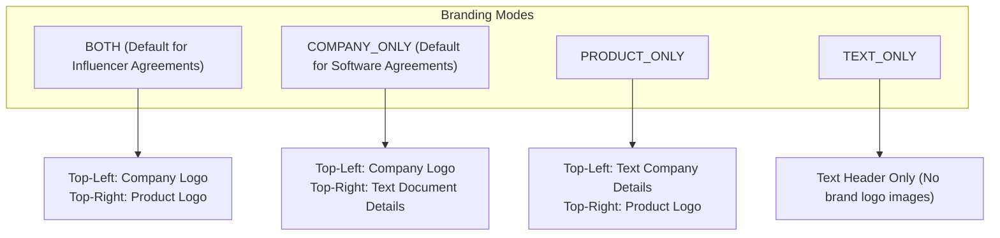

# Standardized Record Management, Deletion & Archival Policy

**Nextora Creations Invoicing & Enterprise Contract System**  
*Statutory Compliance, Financial Integrity, and Lifecycle Governance*  
**Effective Date:** October 26, 2026  
**Document Version:** 1.0.0  
**Target Entities:** Quotations, Invoices, Clients, Products & Services, Payments, POS Customers, Influencers & Contracts  

---

## 1. Regulatory Context & Statutory Invariants

Nextora Creations operates in India subject to statutory corporate, tax, and accounting standards. Specifically:
1. **Central Goods and Services Tax (CGST) Act, 2017 (Section 31 & Rule 46):**  
   Tax invoices must carry a consecutive sequential serial number unique for a financial year. Once issued, an invoice is a legal tax instrument. It **cannot be deleted or modified**. Corrections must be executed via Credit Notes or Debit Notes under Section 34 of the CGST Act.
2. **Income-tax Act, 1961 (Section 44AA & Rule 6F):**  
   Books of account and other documents must be maintained and preserved for a minimum of 6 years from the end of the relevant assessment year. Ledger entries and payment receipts cannot be expunged.
3. **Contract Act, 1872 & Information Technology Act, 2000:**  
   Executed contracts (agreements accepted or signed by counterparties) constitute binding legal instruments. Deleting executed agreements destroys legal evidentiary proof.

To balance regulatory compliance with software usability, Nextora Creations implements a **Strict Invariant Record Management System**:
- **Drafts without external legal or financial commitment:** May be safely deleted.
- **Issued documents, payments, and active contracts:** Protected against hard deletion; manageable through **Archival**, **Cancellation**, or **Credit Adjustment**.

---

## 2. Entity Lifecycle & Management Matrix

| Entity | Lifecycle State | Allowed Actions | Hard Delete Permitted? | Archival Permitted? | Cancellation / Void Permitted? |
|---|---|---|---|---|---|
| **Quotation** | `DRAFT` (No quotation #) | Edit, Send, Delete | **YES** | No | No |
| | `SENT` / `ACCEPTED` / `EXPIRED` | PDF, Duplicate, Transition | **NO** (Locked terms) | Yes | Yes (Record reason note) |
| | `CONVERTED` | PDF, View Invoice | **NO** (Referential lock) | Yes | No |
| **Invoice** | `DRAFT` (No invoice #, 0 payments) | Edit, Issue, Delete | **YES** | No | No |
| | `ISSUED` (Unpaid) | PDF, Payment, Cancel, Credit Note | **NO** (Tax document) | No | Yes (`CANCELLED` with audit reason) |
| | `ISSUED` (Partially/Fully Paid) | PDF, Payment, Credit Note | **NO** (Tax document) | No | No (Issue Credit Note to adjust) |
| **Payment Receipt** | `RECORDED` | View Receipt, Download PDF | **NO** (Ledger invariant) | No | Credit note / offsetting transaction |
| **Client** | `ACTIVE` (0 references) | Edit, Archive, Delete | **YES** | Yes | No |
| | `ACTIVE` (Referenced in docs) | Edit, Archive | **NO** (Protected: 409 `CLIENT_IN_USE`) | **YES** (Recommended) | No |
| | `ARCHIVED` | Edit, Restore | **NO** (Preserves audit history) | Active toggle | No |
| **Product / Service** | `ACTIVE` (0 references) | Edit, Deactivate, Delete | **YES** | Yes | No |
| | `ACTIVE` (Referenced in items) | Edit, Deactivate, Archive | **NO** (Protected: 409 `PRODUCT_IN_USE`)| **YES** (Recommended) | No |
| **POS Customer** | `ACTIVE` | Edit, Subscriptions, Archive | **NO** (Protected if invoices exist) | **YES** | No |
| **Influencer Partner** | `ACTIVE` (0 contracts, 0 sales) | Edit, Create Contract, Delete | **YES** | Yes | No |
| | `ACTIVE` (Has contracts/sales) | Edit, Create Contract | **NO** (Protected: 409 `INFLUENCER_IN_USE`)| **YES** (Status: `ARCHIVED`) | Status: `INACTIVE` |
| **Influencer Agreement**| `DRAFT` / `PENDING_APPROVAL` | Edit, Approve, Delete | **YES** (If 0 sales attributions) | No | Yes (`CANCEL`) |
| | `SIGNED` / `ACTIVE` / `TERMINATED`| PDF, Duplicate, Archive | **NO** (Commercial commitment) | **YES** (`ARCHIVED`) | Yes (`CANCELLED`) |
| **Software Contract** | `DRAFT` / `PENDING_APPROVAL` | Edit, Approve, Delete | **YES** | No | Yes (`CANCEL`) |
| | `SIGNED` / `ACTIVE` / `COMPLETED` | PDF, Duplicate, Archive | **NO** (Commercial commitment) | **YES** (`ARCHIVED`) | Yes (`CANCELLED`) |

---

## 3. Detailed Entity Rules

### 3.1 Quotations
- **Safe Draft Deletion:**
  - Route: `DELETE /api/quotations/:id`
  - Invariant: Allowed strictly when `status === 'DRAFT'` and `quotation_number IS NULL`.
  - Effect: The draft record and line items are removed; an audit event `QUOTATION_DRAFT_DELETED` is logged.
- **Issued Quotation Protection:**
  - Once sent, a quotation receives a sequential quotation number (e.g., `NC/QT/2026-27/0001`) and commercial terms are snapshotted.
  - Hard delete is rejected with HTTP 409 `NOT_DELETABLE`: *"Only unsent drafts can be deleted. Cancel an issued quotation instead."*
  - Allowed transition: Change status to `CANCELLED` or `REJECTED` with an audit note explaining the business rationale.

### 3.2 Invoices
- **Safe Draft Deletion:**
  - Route: `DELETE /api/invoices/:id`
  - Invariant: Allowed strictly when `status === 'DRAFT'`, `invoice_number IS NULL`, and payment count is `0`.
  - Effect: Unlinks source quotation if converted (`converted_invoice_id = NULL`), deletes draft lines, and logs `INVOICE_DRAFT_DELETED`.
- **Issued Invoice Protection (GST Law):**
  - Once issued, an invoice receives a sequential tax invoice number (e.g., `NC/INV/2026-27/0001`) and locks the financial snapshot.
  - Hard delete is rejected with HTTP 409 `NOT_DELETABLE`: *"Only unissued drafts can be deleted. Cancel the invoice instead."*
  - If unpaid, an invoice may be moved to `CANCELLED` status with mandatory reason documentation.
  - If payments have been collected, cancellation is blocked. A Credit Note must be issued under Section 34 of the CGST Act to reverse taxable supply.

### 3.3 Payments and Receipts
- **Ledger Invariant:**
  - Every payment allocated against an invoice generates an immutable sequential receipt (e.g., `NC/REC/2026-27/0001`).
  - Hard delete endpoints are not provided for payment receipts.
  - The UI provides **View Receipt** and **Download Receipt PDF** actions.
  - In the event of payment cancellation or chargeback, an offsetting credit note or accounting adjustment is recorded.

### 3.4 Clients
- **Referential Integrity Constraints:**
  - Route: `DELETE /api/clients/:id`
  - Dependent Tables Checked:
    1. `inv.quotations` (`client_id`)
    2. `inv.invoices` (`client_id`)
    3. `inv.software_agreements` (`client_id`)
    4. `inv.pos_customers` (`client_id`)
  - If any dependent records exist:
    - Return HTTP 409 `CLIENT_IN_USE`: *"This client is referenced by quotations, invoices, software contracts, or POS subscriptions. Archive the client instead of deleting to preserve tax audit records."*
  - If zero dependent records exist:
    - Hard delete is executed; `CLIENT_DELETED` logged to audit trail.
- **Archival Alternative:**
  - Clients with commercial history can be archived via `POST /api/clients/:id/status` with `status: 'ARCHIVED'`.
  - Archived clients are excluded from dropdown pickers for new documents, but all historical documents, reports, and audit logs continue to display complete legal client details.

### 3.5 Products & Services Catalog
- **Referential Integrity Constraints:**
  - Route: `DELETE /api/products/:id`
  - Dependent Tables Checked:
    1. `inv.quotation_items` (`product_id`)
    2. `inv.invoice_items` (`product_id`)
    3. `inv.pos_customers` (`plan_product_id`)
  - If any dependent records exist:
    - Return HTTP 409 `PRODUCT_IN_USE`: *"This product is referenced in quotations, invoices, or POS subscriptions. Deactivate or archive the product instead to preserve historical records."*
  - If zero dependent records exist:
    - Hard delete is executed; `PRODUCT_DELETED` logged to audit trail.
- **Archival Alternative:**
  - Products can be set to `ARCHIVED` status. They remain in catalog history for revenue reports and POS tracking, but cannot be selected on new line items.

### 3.6 Influencers & Marketing Contracts
- **Influencer Record Protection:**
  - Route: `DELETE /api/marketing/influencers/:id`
  - Dependent Tables Checked:
    1. `inv_influencer_agreements` (`influencer_id`)
    2. `inv_influencer_sales_attributions` (`influencer_id`)
  - If referenced: Rejected with HTTP 409 `INFLUENCER_IN_USE`: *"Cannot delete influencer with associated contracts or sales attributions. Set their status to INACTIVE or ARCHIVED instead."*
  - If unreferenced: Deleted permanently; audit event `INFLUENCER_DELETED` written.
- **Influencer Marketing Agreements:**
  - Draft Deletion: `DELETE /api/marketing/agreements/:id`
    - Allowed strictly when `status IN ('DRAFT', 'PENDING_APPROVAL')` and no sales attributions exist.
    - If sales attributions exist: Blocked with HTTP 409 `AGREEMENT_IN_USE`.
  - Non-Draft Protection:
    - Agreements in `ACCEPTED`, `SIGNED`, `ACTIVE`, or `TERMINATED` state cannot be deleted.
    - Supported lifecycle actions:
      - `POST /api/marketing/agreements/:id/archive`: Sets status to `ARCHIVED`. Retained in financial reports and audit logs.
      - Status Transition `CANCEL`: Marks agreement as `CANCELLED` with audit notes.
- **Software Services Agreements:**
  - Draft Deletion: `DELETE /api/marketing/software-agreements/:id`
    - Allowed strictly when `status IN ('DRAFT', 'PENDING_APPROVAL')`.
  - Non-Draft Protection:
    - Agreements in `ACCEPTED`, `SIGNED`, `ACTIVE`, or `COMPLETED` cannot be deleted.
    - Supported lifecycle actions:
      - `POST /api/marketing/software-agreements/:id/archive`: Sets status to `ARCHIVED`.
      - Status Transition `CANCEL`: Sets status to `CANCELLED`.

---

## 4. Contract Branding Modes

Both Influencer and Software Agreements support explicit branding modes preserved across database records, snapshots, HTML preview, and PDF generation:

### Fallback Guarantee:
If a logo file does not exist on disk or has not been uploaded, the PDF and preview generators cleanly fall back to high-resolution typographic letterhead rendering without broken image icons or spacing collapses.

---

## 5. Audit Trail & Recoverability

Every record lifecycle modification writes to `inv.audit_log`:
- **Timestamp:** ISO 8601 UTC timestamp.
- **Actor:** Authenticated user ID, role, and client IP address.
- **Action Type:** `QUOTATION_DRAFT_DELETED`, `INVOICE_DRAFT_DELETED`, `CLIENT_DELETED`, `PRODUCT_DELETED`, `INFLUENCER_DELETED`, `AGREEMENT_DRAFT_DELETED`, `AGREEMENT_ARCHIVED`, `SOFTWARE_AGREEMENT_DRAFT_DELETED`, `SOFTWARE_AGREEMENT_ARCHIVED`.
- **Entity Identification:** Document ID and sequential identifier.
- **Metadata:** Contextual details including cancellation reasons and transition parameters.

Audit logs are strictly append-only and cannot be updated or purged by application users.
