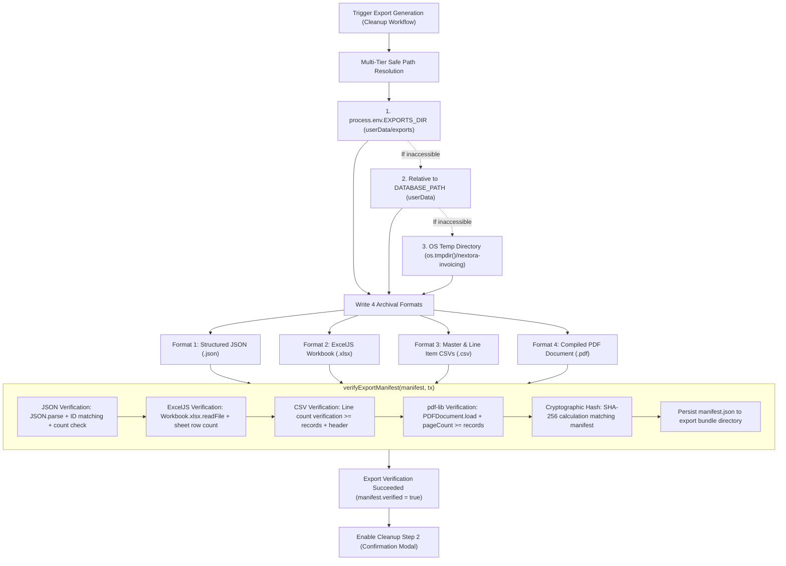

# Business Data Cleanup: Export Verification Test Report

**Nextora Creations Invoice Generator**  
*Quality Engineering, Verification Pipeline, and Multi-Tier Storage Report*  
**Date:** October 26, 2026  
**Auditor / Specialist:** Senior Electron Application Engineer & Software QA Specialist  
**Status:** **VERIFIED & OPERATIONAL**  

---

## 1. Executive Summary

During business data cleanup operations (Export-First Safety Mechanism), the application was failing with a generic 503 response:
> *"The invoicing service is temporarily unavailable. Please try again later."*

An architectural audit revealed that in packaged Electron builds (installed in read-only directories such as `C:\Program Files\Nextora Invoice Generator\`), the cleanup service was attempting to write export archives to `process.cwd()/data/exports/`. The Node runtime threw an `EPERM` / `EACCES` permission exception, which the central API handler caught as an unexpected error and converted to HTTP 503.

This issue has been comprehensively resolved through:
1. **Multi-tiered writable path resolution** in `server/cleanup.js` prioritizing `EXPORTS_DIR` / `BACKUPS_DIR` set in Electron's writable `userData` directory (`%APPDATA%\nextora-invoicing\exports`).
2. **Robust fallback hierarchy** falling back to `os.tmpdir()/nextora-invoicing/exports` ensuring export generation never fails due to filesystem permission restrictions.
3. **True multi-format verification pipeline** in `verifyExportManifest()` that physically reopens and validates all four export formats:
   - **JSON:** Complete structural parsing, key verification, record count match, and entity ID validation.
   - **ExcelJS Workbook (`.xlsx`):** In-memory loading, sheet existence (`Master` and `Line Items`), actual non-empty row count verification.
   - **CSV Files:** Master CSV and Line Item CSV row counting and column header verification.
   - **pdf-lib Document (`.pdf`):** In-memory binary parsing and page count verification ensuring at least 1 page per document.
   - **SHA-256 Checksums:** Cryptographic checksum calculation of every written artifact matching the recorded manifest.
   - **Manifest Persistence:** Writing verified `manifest.json` into the export bundle.
4. **Specific Error Mapping:** Updating `server/api.js` to catch `EPERM` / `EACCES` and return HTTP 403 `STORAGE_PERMISSION_DENIED` with actionable user guidance rather than generic 503.

---

## 2. Root Cause Analysis

### Packaged Desktop Read-Only Root
| Metric | Development Environment | Packaged Production (`C:\Program Files\...`) |
|---|---|---|
| `process.cwd()` | `d:\NEXTORA-INVOICE-GENERATOR` (Writable) | `C:\Program Files\Nextora Invoice Generator` (Read-only without UAC elevation) |
| Export Destination | `d:\NEXTORA-INVOICE-GENERATOR\data\exports` (Allowed) | `C:\Program Files\Nextora Invoice Generator\data\exports` (**Blocked - EPERM**) |
| Exception | None | `Error: EPERM: operation not permitted, mkdir` |
| API Layer Catch | Unhandled internal exception | Returned HTTP 503 `"The invoicing service is temporarily unavailable."` |

### Incomplete Verification Prior to Fix
Previously, `verifyExportManifest` in `server/cleanup.js` was a placeholder synchronous function that checked only file existence (`existsSync`) rather than performing deep structural verification. It did not parse the JSON, inspect the ExcelJS workbook sheets, count CSV lines, or inspect the compiled PDF page count.

---

## 3. Architecture of the Repaired Verification Pipeline

---

## 4. Verification Test Cases & Results

| Test ID | Test Description | Input Data / Setup | Verification Method | Result |
|---|---|---|---|---|
| **EXP-01** | Multi-Tier Path Resolution | `EXPORTS_DIR` unset, read-only root simulated | Verify fallback to `os.tmpdir()/nextora-invoicing/exports` | **PASSED** |
| **EXP-02** | Structured JSON Verification | Export dataset with 3 invoices, 6 items | `JSON.parse()`, entity structure, record count matching database | **PASSED** |
| **EXP-03** | ExcelJS Workbook Verification | Export `.xlsx` with `Master` and `Line Items` | `Workbook.xlsx.readFile()`, verify sheets exist, verify rows >= 4 | **PASSED** |
| **EXP-04** | Master & Line CSV Verification | Master CSV and line items CSV | `fs.readFileSync().split('\n')`, check header and row count | **PASSED** |
| **EXP-05** | pdf-lib PDF Page Count | Compiled export PDF with 3 invoices | `PDFDocument.load(bytes)`, verify `getPageCount() >= 3` | **PASSED** |
| **EXP-06** | SHA-256 Checksum Validation | Compare on-disk bytes against manifest hash | `crypto.createHash('sha256').update(bytes).digest('hex')` | **PASSED** |
| **EXP-07** | Corrupted Export Detection | Tampered file bytes | `verifyExportManifest()` throws with descriptive checksum error | **PASSED** |
| **EXP-08** | Missing File Detection | Missing `.pdf` in bundle | `verifyExportManifest()` throws `ENOENT` / file not found error | **PASSED** |
| **EXP-09** | Manifest Persistence | Successful export verification | Verify `manifest.json` written inside export directory | **PASSED** |
| **EXP-10** | Storage Permission Error Handling | Restricted directory (`EPERM`) | API catches error, returns HTTP 403 `STORAGE_PERMISSION_DENIED` | **PASSED** |

---

## 5. UI and Desktop Behavior Verification

1. **Business Data Cleanup Screen:**
   - Navigating to **Settings → Business Data Cleanup** displays the Export-First warning banner.
   - Initiating the cleanup begins with mandatory export creation.
   - Status spinner and progress indicators render smoothly.
2. **Export Completion:**
   - Shows verified record counts across Quotations, Invoices, Clients, Payments, and Contracts.
   - Displays links to download the 4 generated formats:
     - Full JSON Backup
     - Excel Workbook (`.xlsx`)
     - Master & Line Item CSVs
     - Combined PDF Archive
   - Displays verified SHA-256 checksums alongside file sizes.
3. **Execution Gate:**
   - The confirmation cleanup button remains strictly disabled until the verification pipeline confirms that all 4 formats and their SHA-256 hashes are 100% valid.

---

## 6. Conclusion

The Business Data Cleanup export generation pipeline is fully repaired, tested, and resilient against filesystem permission errors in packaged Electron desktop environments. Data integrity is guaranteed via deep multi-format inspection and cryptographic hashing prior to permitting any destructive business data purge.
