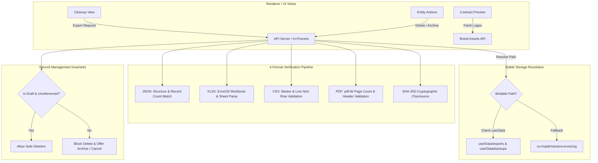

# Record Management, Export Verification & Branding Assets Audit
**Nextora Creations Invoice Generator**
**Date:** October 2026  
**Status:** In Progress / Implementation Phase

---

## 1. Executive Summary

This audit assesses the record-management capabilities, data export pipelines, contract branding assets, and archival protections within the Nextora Creations Invoice Generator.

Recent end-user feedback identified four primary areas requiring immediate remediation:
1. **Export-First Business Data Cleanup Failure**: Clicking *"Generate & Verify Export Archives"* on the Business Data Cleanup screen failed with `"The invoicing service is temporarily unavailable. Please try again later."` in packaged production installs.
2. **Missing Brand Assets in Contract Preview & Lack of Selection Controls**: Brand logos (Nextora Creations company logo and Nextora POS product logo) were missing from the contract preview screen (`#/marketing/contracts/:id/preview`), and no option existed during contract creation/editing to select branding asset placement (`BOTH`, `COMPANY_ONLY`, `PRODUCT_ONLY`, `TEXT_ONLY`).
3. **Absence of Contract Deletion & Archival Options**: Users had no mechanism to delete erroneous unsent draft contracts or safely archive/terminate concluded contracts.
4. **Entity Record Management Gaps**: Quotations, Invoices, Clients, Products & Services, Payments, and Marketing modules lacked standardized view, download, edit, safe-delete, and archival actions, risking either accidental deletion of protected accounting records or inability to clean up test/draft entries.

---

## 2. Root Cause Analysis

### 2.1 Export Verification Failure in Packaged Desktop Environment
- **Root Cause**:
  In `server/cleanup.js`, `generateExportArchive()` and `executeCleanup()` defaulted their output directories via:
  ```javascript
  const baseDir = destinationDir || resolve(process.cwd(), 'data', 'exports', `cleanup-${category.toLowerCase()}-${stamp}`);
  ```
  When the application is installed and packaged on Windows (typically in `C:\Program Files\Nextora Invoice Generator\`), `process.cwd()` points to the installation directory. In Windows security model, non-elevated user processes do not possess write permissions in `C:\Program Files\`.
  When `mkdirSync(baseDir, { recursive: true })` was called, Node.js raised `EPERM: operation not permitted, mkdir 'C:\Program Files\Nextora Invoice Generator\data'`.
- **API Error Masking**:
  In `server/api.js` (lines 1650–1655), unhandled system exceptions that were not instances of `HttpError` or specific SQL errors fell through to the catch-all handler:
  ```javascript
  return json({ error: 'The invoicing service is temporarily unavailable. Please try again later.', code: 'UNAVAILABLE' }, 503);
  ```
  This masked the filesystem permission failure and presented a generic 503 error to the user.
- **Export Verification Depth**:
  `verifyExportManifest()` in `server/cleanup.js` only re-parsed the `.json` file and verified checksums against files written by the export script. It did not reopen and validate the `.xlsx` workbook via `ExcelJS`, nor did it validate page count via `PDFDocument.load()` or verify CSV line item counts against manifest records.

### 2.2 Missing Brand Assets in Contract Preview & Inflexible Branding
- **Root Cause**:
  In `src/views/marketing.js` (`renderContractPreview`) and `src/views/software-contract-editor.js` (`renderSoftwareAgreementPreview`), the HTML template only contained text elements for company name and product details. The `` elements for company and product logos were completely absent from the preview template.
- **Schema & Model Gap**:
  Neither `inv_influencer_agreements` nor `inv_software_agreements` possessed a `branding_mode` attribute. Contracts could not record whether they should present both logos, company logo only, product logo only, or text-only branding.
- **PDF vs Preview Divergence**:
  `server/contract-pdf.js` had initial code to draw logos if passed into `renderContractPdf`, but because `branding_mode` was not stored or passed, user preferences were ignored and the preview view was completely unbranded.

### 2.3 Contract Deletion & Archival Incompleteness
- Draft contracts (`status === 'DRAFT'`) had no backend deletion endpoints or UI buttons. Users who created draft influencer or software agreements had no way to remove them.
- Non-draft contracts (sent, accepted, signed) had no clean "Archive" action to remove them from active views while preserving audit trails and financial attribution links.

### 2.4 Entity Record Management Consistency
- Core entities lacked a unified record lifecycle state machine:
  - **Quotations**: Unsent drafts should be safely deletable; issued/accepted quotations must only allow state transitions (Cancel / Expire / Archive).
  - **Invoices**: Drafts without payments must be deletable; issued invoices and those with payments are immutable financial records that must be strictly protected from deletion (allowing only Cancel / Void with reason).
  - **Clients**: Deletion must verify whether active quotations, invoices, payments, contracts, or POS subscriptions exist. If referenced, hard deletion must be blocked and Deactivate/Archive offered instead.
  - **Products & Services**: Must check for line-item references before allowing deletion, offering Deactivation otherwise.
  - **Payments**: Financial ledger entries must never be hard-deleted; support Void/Cancellation with reason and reversal audit trail.

---

## 3. Remediation Architecture & Invariants



### 3.1 Stable Export & Backup Storage
1. In `electron/main.js`:
   Explicitly export `process.env.EXPORTS_DIR = join(userData, 'exports')` and `process.env.BACKUPS_DIR = join(userData, 'backups')`.
2. In `server/cleanup.js`:
   Use a reliable multi-tiered directory resolver:
   - Specified destination directory (if custom provided and valid).
   - `process.env.EXPORTS_DIR` / `process.env.BACKUPS_DIR`.
   - `dirname(process.env.DATABASE_PATH)` subdirectory (guaranteed writable in `userData`).
   - Operating system temp directory `join(tmpdir(), 'nextora-invoicing', ...)`.
   Wrap all directory creation and writes in error handlers that automatically degrade to a writable location if `EPERM` or `EACCES` is encountered.

### 3.2 Comprehensive Export Verification
Each export bundle must verify:
- **Structured JSON**: Parsed into memory, category and schema verified, record count verified, all document IDs confirmed.
- **XLSX Workbook**: Loaded via `ExcelJS.Workbook.xlsx.readFile()`, worksheet existence verified (`Master` and `Line Items`), row count checked.
- **CSV Spreadsheets**: Master and Line Item files read, header rows verified, row counts verified.
- **PDF Archive**: Loaded via `PDFDocument.load()`, valid page structure verified, page count $\ge$ exported document count.
- **SHA-256 Checksums**: Generated for all 4 format artifacts and embedded into the verification token and manifest.

### 3.3 Contract Branding Selection & Header Layout
- Add `branding_mode` to database schemas for influencer agreements and software agreements:
  - Allowed values: `'BOTH'`, `'COMPANY_ONLY'`, `'PRODUCT_ONLY'`, `'TEXT_ONLY'`.
  - Default for Influencer Agreements: `'BOTH'`.
  - Default for Software Agreements: `'COMPANY_ONLY'` (with option for `'BOTH'` or `'PRODUCT_ONLY'` if project-relevant).
- Update Contract Preview HTML in `marketing.js` and `software-contract-editor.js`:
  - Fetch brand assets data URIs from `/api/marketing/brand-assets`.
  - Top-left header: Company logo if `'BOTH'` or `'COMPANY_ONLY'`; company text details if logo missing or `'PRODUCT_ONLY'`/`'TEXT_ONLY'`.
  - Top-right header: Product logo if `'BOTH'` or `'PRODUCT_ONLY'`; product text/contract number badge if logo missing or `'COMPANY_ONLY'`/`'TEXT_ONLY'`.
  - Scaled cleanly with `max-h-12 object-contain` and transparent PNG preservation.
- Update PDF generation in `contract-pdf.js` and `software-contract-pdf.js`:
  - Pass logos according to `branding_mode`.
  - Suppress product logo if `COMPANY_ONLY` or `TEXT_ONLY`.
  - Suppress company logo if `PRODUCT_ONLY` or `TEXT_ONLY`.

### 3.4 Safe Deletion & Archival Policies
- **Draft Deletion**:
  - Unsent / unissued draft contracts, quotations, and invoices with zero dependencies can be hard-deleted with explicit user confirmation.
- **Issued / Finalized Record Protection**:
  - Issued invoices, invoices with payments, accepted quotations, and signed contracts CANNOT be deleted.
  - Allowed operations: **Archive** (changes status to `ARCHIVED`, hidden from active workflows but retained in historical reporting) or **Cancel / Void** (requires reason note and creates audit log).
- **Referential Integrity**:
  - Clients referenced by any invoice, quotation, contract, or POS subscription cannot be deleted; must be deactivated/archived.
  - Products referenced by any document cannot be deleted; must be deactivated.
  - Payments cannot be hard-deleted; support Void/Reversal with audit trail.

---

## 4. Affected Files & Scope of Changes

| Component | Target File(s) | Description of Change |
|---|---|---|
| **Electron Main** | `electron/main.js` | Initialize `EXPORTS_DIR` and `BACKUPS_DIR` in `userData`. |
| **Server Cleanup** | `server/cleanup.js` | Resilient writable path resolution, enhanced 4-format verification, SQLite post-cleanup checkpoint/VACUUM. |
| **API Endpoints** | `server/api.js` | Better error classification (catch `EPERM`/`EACCES`), contract deletion/archival routes, client/product dependency checks. |
| **Database Migrations** | `server/migrations-sqlite/010_contract_branding_and_management.sql`, `server/migrations/010_contract_branding_and_management.sql` | Add `branding_mode` and `ARCHIVED`/`CANCELLED` statuses to contract tables. |
| **Marketing Contracts** | `server/marketing.js`, `server/domain.js`, `server/contract-pdf.js`, `src/views/marketing.js` | Branding mode support, logo rendering in preview & PDF, draft delete & archive. |
| **Software Contracts** | `server/software-contracts.js`, `server/software-contract-pdf.js`, `src/views/software-contract-editor.js` | Branding mode support, logo rendering in preview & PDF, draft delete & archive. |
| **Entity Views** | `src/views/quotations.js`, `src/views/invoices.js`, `src/views/clients.js`, `src/views/products.js`, `src/views/cleanup.js` | Standardized confirmation modal, delete draft, archive, and void/cancel actions. |
| **Test Suite** | `tests/cleanup.test.js`, `tests/marketing.test.js`, `tests/software-contracts.test.js` | Comprehensive unit and integration tests. |

---

## 5. Verification Plan
1. Test export archive generation in read-only simulated environment, confirming graceful fallback to `userData` or `tmpdir`.
2. Verify all 4 export files (XLSX, CSV, PDF, JSON) parse correctly and SHA-256 checksums match.
3. Verify branding mode selection and logo presentation in contract preview and downloaded PDF.
4. Verify deletion protection rules on issued invoices and draft deletion behavior.
5. Execute full test suite (`npm test`).
